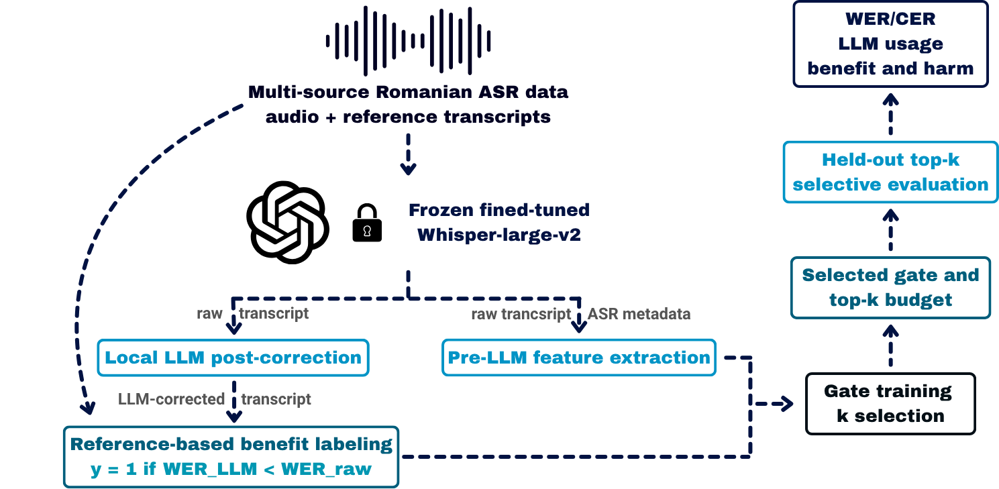

# Whisper + LLM Post-Correction for Romanian ASR

This project investigates whether a **local LLM running through Ollama** can conservatively improve transcripts produced by a **fine-tuned Romanian Whisper model**. Performance is measured using Word Error Rate (WER) and Character Error Rate (CER) before and after correction, without paid APIs.



## Setup

```bash
python -m venv .venv
.venv\Scripts\activate
pip install -r requirements.txt
```

For Linux/macOS, activate the environment with `source .venv/bin/activate`. Install a CUDA-compatible version of PyTorch if GPU inference is required.

Install [Ollama](https://ollama.com/), then download and start the local LLM:

```bash
ollama pull llama3.1:8b
ollama serve
```

## Data and configuration

Provide a CSV manifest with the columns `audio_path,text,split,source`. An optional `sample_id` column can identify each sample. Audio paths can be absolute or relative to `audio_root`.

Update `config.yaml` with your dataset, Whisper checkpoint, LLM, and sampling settings. For example:

```yaml
manifest_path: "data/manifest.csv"
audio_root: "data/audio"
whisper_model_path: "FT_ALL_whisper_large_v2"
llm_model: "llama3.1:8b"
split_to_use: "test"
```

## Run

Execute the complete pipeline:

```bash
python run_full_pipeline.py --config config.yaml
```

Or run each stage separately:

```bash
python run_whisper_transcription.py --config config.yaml
python run_llm_correction.py --config config.yaml
python evaluate_results.py --config config.yaml
```

## Results

Results are saved under `outputs/`:

- **Predictions:** Whisper transcripts (`predictions/whisper_predictions.csv`).
- **Corrections:** LLM outputs and correction status (`corrections/llm_corrections.csv`).
- **Evaluation:** Per-sample, per-source, and global WER/CER metrics (`metrics/`), including improvement and overcorrection statistics.
- **Future work:** `metrics/features_for_xgboost.csv` supports experiments with a gating model that decides when LLM correction may be helpful.

Processing is incremental. With `resume: true`, completed samples are skipped on reruns. If an LLM request fails, the original Whisper transcript is retained.
